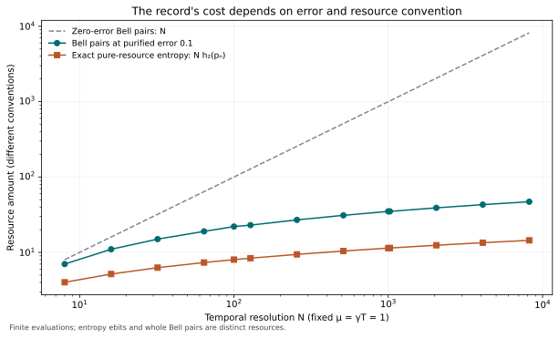

# Quantum Unraveling Cost

**How much shared entanglement does a measurement record require when the unread noise needs none?**

Two remote qubits undergo parity dephasing for a fixed duration. Its unread evolution is a shared-random mixture of local Pauli operations. A jump record is also free to generate. Reproducing its efficient diffusive measurement record, with quantum outputs available for interventions between weak steps, requires a growing supply of shared entanglement.

The central result gives the **exact initial Bell-pair cost at fixed whole-process purified error** and a sharp fixed-time resolution law. It allows arbitrary correlated resources, local storage, adaptation and reuse generated from the charged Bell supply. Local operations and classical communication are free; quantum communication is absent.

## Same generator, different resource costs

Fix positive $`\gamma,T`$, write $`\mu=\gamma T`$, and use $`N`$ weak steps with $`p_N=(1-e^{-2\mu/N})/2`$. All three rows below have the unread generator $`\mathcal L(\rho)=\gamma(Q\rho Q-\rho)`$, where $`Q=Z_A\otimes Z_B`$.

| Requested experiment | Initial Bell supply |
|---|---|
| Unread evolution, with arbitrary interventions | Zero |
| Jump record and quantum outputs, with arbitrary interventions | Zero |
| Efficient diffusive record and quantum outputs, with arbitrary interventions | Exact finite-error formula below; logarithmic in resolution when the tolerance is small enough |

The distinction is the complete recorded instrument, including its backaction and accessible quantum outputs. Matching measurement probabilities or the final unread state does not implement that task.

## Exact finite-error law

The [model](science/model.md) defines the causal error and resource account. One weak step has public sign $`s=\pm1`$ and Kraus operator

```math
M_s=\frac{\sqrt{1-p}\,I+s\sqrt p\,Q}{\sqrt2}.
```

The entire process is [LOCC-equivalent](science/resource_equivalence.md) to $`N`$ copies of the pure shared meter $`|\phi_p\rangle=\sqrt{1-p}|00\rangle+\sqrt p|11\rangle`$. If its decreasing squared Schmidt coefficients are $`\lambda_j`$, define

```math
R_\epsilon=\min\left\{R:\sum_{j=1}^R\lambda_j\ge1-\epsilon^2\right\}.
```

The minimum initial number of Bell pairs is exactly

```math
\boxed{C_P^\epsilon(N,p)=\lceil\log_2 R_\epsilon\rceil.}
```

This is a uniform guarantee for the whole experiment, including arbitrary causal interventions. It uses a single approximation to the joint meter resource; errors are not added separately over the steps. The [proof](science/bell_cost.md) covers arbitrary correlated simulation strategies and gives an explicit finite binomial formula.

## Fixed duration and increasing resolution

For $`0\lt\epsilon\lt1`$, let

```math
k_\epsilon=\min\{k\ge0:\Pr[\operatorname{Pois}(\mu)\le k]\ge1-\epsilon^2\}.
```

The [resolution theorem](science/poisson_limit.md) proves

```math
\boxed{C_P^\epsilon(N,p_N)=k_\epsilon\log_2 N+O_{\mu,\epsilon}(1).}
```

If $`\epsilon^2\lt1-e^{-\mu}`$, the coefficient is positive. If the error tolerance is large enough that $`k_\epsilon=0`$, zero Bell pairs suffice. For sufficiently small fixed half-trace-distance error the cost also has logarithmic order; its exact finite-error optimum is not identified with the purified-distance formula.

For example, at $`\mu=1`$ and purified error $`\epsilon=0.1`$, the coefficient is four. The exact finite formula needs 22 Bell pairs at $`N=100`$ and 35 at $`N=1000`$. These are supply counts in the ideal local-operation model, not hardware estimates.



At zero error the exact Bell supply is $`N`$. Minimizing initial entanglement of formation over arbitrary finite shared states instead gives $`N h_2(p_N)\sim\mu\log_2N`$ for an exact simulation. The [resource-convention account](science/exact_resources.md) explains why those statements differ.

## Robustness to a noisy retained sign

The [inefficient-record theorem](science/inefficient_record.md) keeps the unread dynamics fixed and passes each ideal sign through a binary symmetric channel. Write its known efficiency parameter as $`0\le\zeta\le1`$; the sign-flip probability is $`(1-\sqrt\zeta)/2`$. For every fixed $`\zeta>0`$, logarithmic Bell supply survives at fixed whole-process half-trace error

```math
0<\epsilon<\zeta\mu e^{-\mu}.
```

A mixed-state entanglement witness proves the lower bound, and a locally dephased approximation to the joint meter resource gives the upper. At $`\zeta=0`$ the retained sign is a fair coin and the process is entanglement-free. The sharp Poisson coefficient above is for the efficient instrument; no exact coefficient is claimed for the noisy record.

## Read and reproduce

Start with the [scientific route](science/README.md), [model](science/model.md), [resource equivalence](science/resource_equivalence.md), and [unraveling comparison](science/unraveling_gap.md). The [continuum and cadence discussion](science/continuum_and_cadence.md) states precisely what the limiting result means. The [related-work account](references/RELATED_WORK.md) credits the existing weak meter and resource-simulation machinery.

Run the finite checks from the repository root:

```sh
python -m pip install -r requirements.txt
python tools/verify.py
```

The [verification guide](verification/README.md) identifies the checked algebra, finite spectra, examples and numerical limitations. Analytical proofs establish the all-size claims. The [LLM reading guide](llms.txt) maps questions to authoritative pages.

## Physical scope

The divergent limit permits increasingly frequent local interventions and retention of intermediate outputs during a fixed experiment. A restricted experiment with only initial/final quantum access has a bounded-cost realization. This does not assert infinite cost for every fixed-bandwidth physical monitor. Local memory, communication delay, detector inefficiency, gate synthesis and thermodynamic reset are separate resources or models.

## Purpose and contact

This repository serves as a record of the work and a guide for the author’s self-directed learning. For discussion or potential collaboration, please contact Ruge Lin at [gogoko699@gmail.com](mailto:gogoko699@gmail.com).
